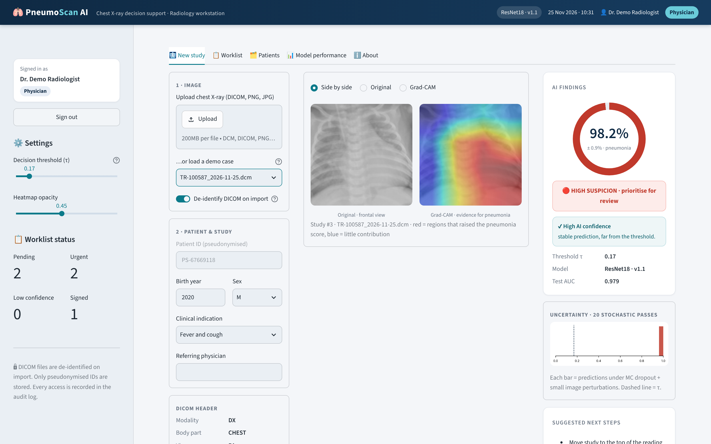

# Pneumonia Detection from Chest X-rays (ResNet18 + Grad-CAM)
COMP 463 – Introduction to Medical Informatics · Term Project · Elif Erkişi (042401169)



Report: [docs/Report.pdf](docs/Report.pdf) · Slides: [docs/Presentation.pptx](docs/Presentation.pptx)

## Setup
```bash
pip install -r requirements.txt
```

## Data
- **PneumoniaMNIST 128×128** (used in the report): `python download_data.py --size 128` → `data/pneumoniamnist_128.npz`
- **Kaggle Chest X-Ray (Kermany et al.)** also works: unzip to `data/chest_xray/{train,val,test}/{NORMAL,PNEUMONIA}` and pass `--data data/chest_xray`.

## Reproduce the results
```bash
python src/train.py    --data data/pneumoniamnist_128.npz --epochs 15      # ~14 min on a 4-core CPU
python src/evaluate.py --data data/pneumoniamnist_128.npz --ckpt checkpoints/best_model.pt
python src/baseline.py --data data/pneumoniamnist_128.npz                  # logistic-regression baseline
```
Metrics and figures are written to `results/`. The trained model is already included in `checkpoints/best_model.pt`, so you can skip training.

## Demo app
```bash
streamlit run app.py
```
Sign in with **dr.demo / demo123** (physician) or **admin / admin123** (administrator). On first run the app creates `data/pneumoscan.db` with two demo studies. Synthetic DICOM cases (fictitious patients) are in `samples/dicom/`.

**New in v1.1:** DICOM import with de-identification (`src/dicom_io.py`), SQLite patient record and prior-study comparison (`src/db.py`), role-based access and audit trail, and an uncertainty/confidence flag from MC dropout + test-time augmentation (`src/uncertainty.py`, evaluated with `python src/evaluate_uncertainty.py --data data/pneumoniamnist_128.npz`).

Open http://localhost:8501. **PneumoScan AI** has three tabs:
- **New study:** patient/study panel, image viewer (original / Grad-CAM / side by side), AI findings with probability gauge and triage level, suggested next steps, and an editable preliminary report that can be downloaded as PDF after the physician confirms review. Upload an X-ray or pick a demo case from `samples/`.
- **Model performance:** test metrics, model comparison, ROC curve, confusion matrix, training curves, Grad-CAM examples.
- **About the project:** purpose, intended use, limitations.

The sidebar has the decision threshold, heatmap opacity and a session worklist.

## Files
| File | Purpose |
|---|---|
| `src/data.py` | Data loading, augmentation, class-balanced sampling |
| `src/model.py` | ResNet18 adapted to 1-channel input |
| `src/train.py` | Training loop (AdamW, cosine LR, keeps best validation AUC) |
| `src/evaluate.py` | Test metrics, threshold selection, ROC, confusion matrix, Grad-CAM figures |
| `src/gradcam.py` | Grad-CAM explainability |
| `src/baseline.py` | Logistic-regression baseline |
| `src/uncertainty.py` | MC-dropout + TTA uncertainty, confidence flag |
| `src/evaluate_uncertainty.py` | Checks whether the flag catches the errors |
| `src/dicom_io.py` | DICOM reading, de-identification, demo DICOM creation |
| `src/db.py` | SQLite: users, patients, studies, audit log |
| `make_demo_dicoms.py` | Rebuilds the synthetic DICOM demo cases |
| `app.py` | Streamlit web interface (PneumoScan AI) |
| `.streamlit/config.toml` | UI theme |
| `checkpoints/` | Trained model + training history |
| `results/` | Metrics (JSON), figures, training log |

> Disclaimer: academic project, not a medical device.
